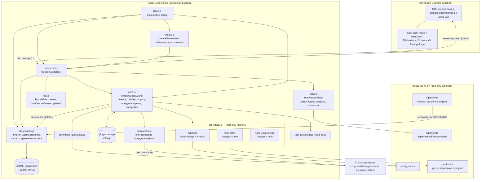
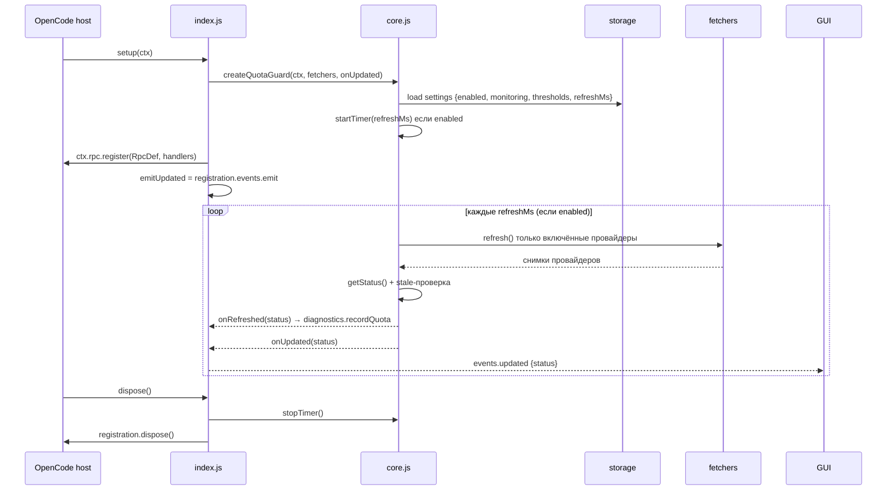
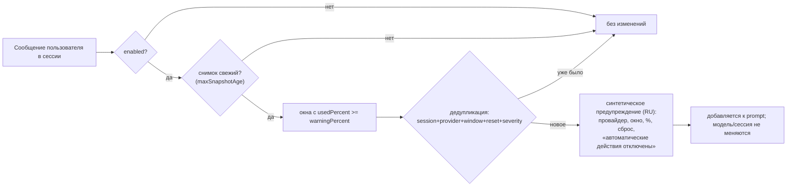
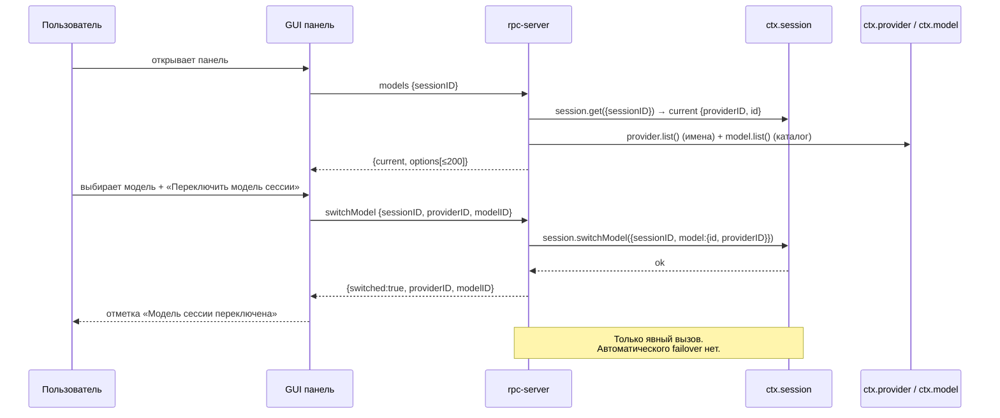
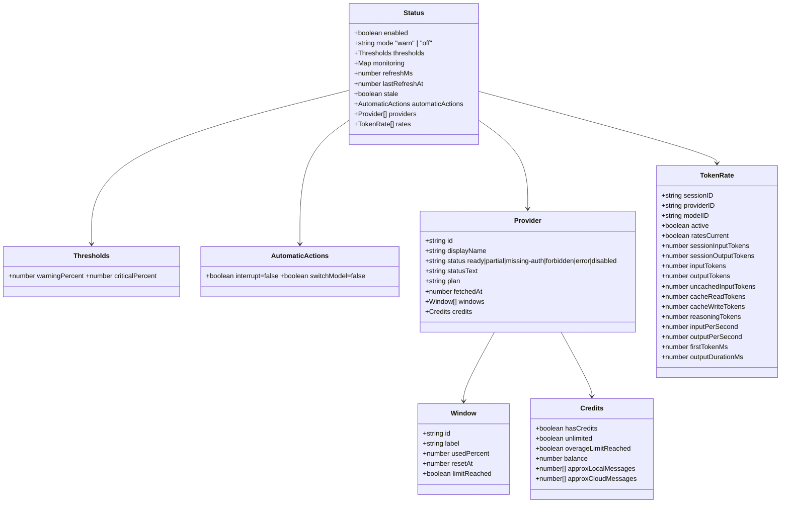

# Архитектура Quota Guard

Версия 0.14.0. Все схемы — Mermaid (рендерятся на GitHub и в большинстве Markdown-просмотрщиков).

## 1. Компоненты

Принципы:

- **Один источник истины** — снимок (`status`) в `core.js`. GUI, команда, tool и RPC читают только его.
- **Fetchers read-only**: только GET-запросы квот; никаких мутаций у провайдеров.
- **Мутации только явные**: `configure` (настройки), `switchModel` (модель сессии). Автоматических мутаций нет.
- **Секреты не покидают server**: fetchers читают auth-store/env/storage; в снимок попадают только коды ошибок, проценты и агрегаты кредитов.
- **Диагностика не мутирует OpenCode**: собственный JSONL — единственная новая запись; whitelist технических скаляров, cross-process lock, дедупликация, 7 дней / 10 МБ, fail-open.

## 2. Жизненный цикл и таймер

Выключенный режим (`enabled=false`): таймер остановлен, `refresh()` не делает запросов, prompt-hook молчит; `getStatus()` возвращает последний снимок с `mode:"off"`.

## 3. Предупреждения (prompt-hook)

Пороги: `warningPercent` (80 по умолчанию) и `criticalPercent` (95). `limitReached` всегда считается критическим. Дедупликация сбрасывается при новом `resetAt` или повышении уровня.

## 4. Ручное переключение модели

Ошибки: `session_not_found` (сессия не существует), `switch_failed` (провайдер/хост отказал). Кнопка в GUI неактивна, пока выбранная модель совпадает с текущей.

## 5. Модель данных снимка

`stale = now - lastRefreshAt > maxSnapshotAge` (6 ч по умолчанию): предупреждения не выдаются по устаревшим данным, панель помечает их как возможные устаревшие. `credits` заполняется только для ChatGPT (поле `credits` ответа `wham/usage`): баланс кредитов плана и ориентировочные диапазоны сообщений; это кредиты подписки, а не денежный баланс OpenAI Platform.

`rates[]` заполняется `meter.js` из read-only событий `session.step.*` и инициализируется по последним assistant-сообщениям текущего location. RPC и событие `updated` передают последние записи `getRates`, чтобы закреплённые карточки не исчезали после завершения шага. GUI в карточке провайдера показывает все его активные шаги либо один последний замер; контейнер остаётся даже с заглушкой «Нет измерений». Отдельный блок прочих LLM фильтрует только `active=true`. `session.usage.updated` обновляет `sessionInputTokens` / `sessionOutputTokens` (вход включает кэш, выход — reasoning). Входная скорость = `input + cache.read + cache.write` за время до первого токена; выходная = `output + reasoning` за время потока. Это средняя скорость завершённого шага, а не мгновенная. У активного шага без его финальных токенов показываются предыдущие метрики с `ratesCurrent=false`; `uncachedInputTokens`, `cacheReadTokens`, `cacheWriteTokens`, `reasoningTokens` описывают тот же завершённый шаг. Вход шага не называется текущим контекстом. Тексты сообщений в снимок не включаются.

`stats` — отдельный RPC, вызываемый только при раскрытии «Статистики и эффективности» или смене периода. `stats.js` через официальный `@opencode/client` и `service.discover` вызывает read-only `experimental/session/stats` с `tools:"none"`. Текущий `day` — локальная полночь до now, его база — предыдущие календарные сутки до того же wall-clock времени; текущий `week` — 7×24 ч, база — непосредственно предшествующие 7×24 ч. Запросы current/baseline независимы; успешный пустой baseline — валидный нулевой агрегат, failed/missing — unavailable. Диапазоны полуоткрытые.

Нормализация использует только сообщённые агрегаты, без оценки покрытия по отдельным записям. Неизвестные значения — `null`, не ноль. Взаимоисключающие U/R/W: U=`input-cache.read-cache.write`, R=`cache.read`, W=`cache.write`; полный вход=U+R+W, полный выход=`output+reasoning`. `readShare=R/(U+R+W)`, `amortization=R/W` — токеновые потоки окна, не lifetime одной записи. Нулевой знаменатель даёт `null`/«—». GUI показывает числитель/знаменатель, состав и сравнения только внутри одного provider+model. Абсолютное отклонение readShare хранится как доля и при отображении умножается на 100 (п.п.). Качество, экономия денег и экономия квоты не выводятся. Область — все проекты OpenCode; Diagnostics не смешивается с этой базой. Собственной базы/истории и текстов сообщений для stats нет.

Каждое сравнение модели содержит `deltas` и независимые `assessment.components.input/cache/reuse` со своими `level`/`reasons`; общий уровень — худший доступный, серый только если серы все компоненты. GUI агрегирует каждый компонент по всем моделям, а не выбирает одну худшую модель для всех KPI. Отсутствующая/пустая база, отсутствие модели в периоде и недостаточные/частичные данные дают серый статус с причиной; числовые дельты в этом состоянии не показываются. Для сопоставимых non-gray компонентов дельты сохраняются. Объём выхода сравнивается как `current.outputTokens` с `baseline.efficiency.outputTokens` и имеет отдельный светофор объёма, не качества. RPC включает `assessment.components` и верхнеуровневый `deltas.secondKpi`; `available=false` текущего периода отображается как недоступность с retry, а не как нулевая статистика.

`diagnostics` — on-demand RPC над существующим локальным журналом, без refresh провайдеров и stats. `diagnostics.js` подписывается только на события своего location, а общий JSONL объединяет location; записи дедуплицируются перед агрегацией. `step.start` и `step.end` соединяются по assistant message ID; модель при отсутствии start берётся из сохранённого assistant-сообщения, не из текущей модели сессии. Компакции являются маркерами и никогда не добавляют свои токены/стоимость к шагам.

Для новых шагов аддитивно сохраняются reasoningTokens и tokenCompleteness (input/output/reasoning/cacheRead/cacheWrite); старые записи имеют completeness=null, без миграции и задней реконструкции. В сравнение моделей попадают только полные корректные пары start/end одной модели. Агрегаты включают cacheWrite/reasoning; RPC `steps[]` ограничен 200 и сортирован по полному входу desc, затем at desc/id. GUI показывает project→session/model→step и подробную карточку; legacy-пробелы явно обозначаются.

Холодный шаг — эвристика `inputTokens >=100000` и `cacheReadPercent <=20`; `noCache` отдельно означает нулевое сообщённое чтение. Пауза — `startedAt` текущего шага минус завершение предыдущего в том же сеансе, иначе `null`. Иерархия строится по `projectID`, `parentID`, `rootID`: project/root totals суммируют фактические различные шаги, а собственные модели root исключают субагентов. Пути и названия сеансов не сохраняются; имена проектов разрешаются read-only при чтении.

Квоты пишутся только через `onRefreshed` для готовых ответов с `fetchedAt`, не из meter/cached/error публикаций. Проценты не суммируются. На шкале скрываются повторные значения с изменением <0,05 п.п.; различие `resetAt` до 2 с считается дрожью округления. Delta выражается в процентных пунктах, снижение/смена окна не выдаётся за рост. `plugin.setup` отмечает загрузку/перезагрузку, `process.started` — один маркер хост-процесса; причина перезапуска не утверждается. Все совпадения на шкале только временные.

## 6. Карта файлов

| Файл | Роль |
| --- | --- |
| `index.js` | точка входа: fetchers, core, meter, diagnostics, RPC, событие `updated`, cleanup |
| `core.js` | снимок, таймер, настройки, пороги, prompt-hook, `/quota-status`, tool; `onRefreshed` отдельно от `onUpdated` |
| `diagnostics.js` | локальный JSONL с Flock, события, cold/pause, иерархия, квоты и timeline; retention/cap, дедупликация, fail-open |
| `meter.js` | подписка на `session.step.*` и `session.usage.updated`, инициализация, расчёт скорости и накопленных токенов, активный список `getActiveRates` |
| `stats.js` | read-only current/baseline периоды, U/R/W и KPI, null-семантика, независимые input/cache/reuse-оценки и model deltas |
| `providers.js` | парсеры и fetchers OpenAI (окна + кредиты) / двух независимых Kimi-аккаунтов (окна + план, разные integration/env без общего ключа); чтение auth-store/env/storage |
| `rpc.js` | `Rpc.define`: схемы input/output (включая `credits`, `rates`, `assessment.components`, `deltas.secondKpi`), типизированные ошибки, событие `updated` |
| `rpc-server.js` | обработчики RPC: status/configure/models/stats/diagnostics/switchModel |
| `src/gui.tsx` | Solid GUI: компактные квоты и CSS-светофоры, состав шага, Stats с независимыми компонентами/gray-семантикой, Diagnostics drilldown/время, управление |
| `vite.config.ts` | сборка GUI (`gui()` preset) → `dist/gui-experimental.cjs` |
| `test/*.test.js` | node:test — 80 тестов: парсеры, независимые Kimi credentials/endpoints, скорость, KPI/null/baseline, component assessments/model deltas, diagnostics storage/aggregation/steps, RPC, инварианты |
| `TEST-PLAN.md` | универсальные AUTO/RPC/Desktop/fixture-проверки, роли QA/приёмщика и протокол публикации |

## 7. Границы ответственности

- Quota Guard **не** управляет биллингом и **не** знает денежных балансов API-платформ (OpenAI Platform, DeepSeek и т.п.) — только подписочные окна и кредиты плана ChatGPT, а также окна Kimi.
- TUI-сайдбар Usage принадлежит стороннему `opencode-usage-monitor`; Quota Guard добавляет Desktop GUI, предупреждения и управление, не вмешиваясь в него.
- Автоматический failover/остановка сознательно отсутствуют: это продуктовое решение безопасности, а не недоделка.
